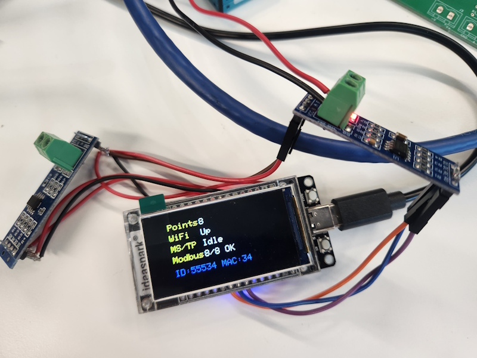

# ESP32 Modbus BACnet Gateway

Repository: <https://github.com/MGuerrero31416/ESP32-MODBUS-BACnet-Gateway>

ESP32/ESP32-S3 gateway: a Modbus RTU client/master on one
RS485 bus, with mapped points exposed over BACnet/IP (Wi-Fi) and BACnet MS/TP
on a second RS485 bus. Board, display, and touch hardware profiles are retained.

## Project baseline

The Ideaspark ESP32-WROOM-32 deployment has been tested successfully with
Modbus RTU polling and both BACnet/IP over Wi-Fi and BACnet MS/TP.

The active mapping table contains **eight read-only points**: four input
registers (FC04, zero-based addresses 0-3) mapped to Analog Inputs 1-4, and four
discrete inputs (FC02, zero-based addresses 0-3) mapped to Binary Inputs 1-4.
The slave must expose these addresses, including address 0. Configured points start
in communication-failure, not as valid zero readings. Only successful fresh
samples clear acquisition faults. A BACnet write acknowledgment means queue
acceptance, not remote execution; Present_Value remains polled readback.
An empty table leaves Modbus idle without installing a UART driver.

See [Point Mapping Configuration](OBJECTS_CONFIGURATION.md) for all fields,
validation rules, address conventions, and disabled examples.
See [dual-transport validation](SETUP.md#dual-transport-validation) for evidence,
test boundaries, and commissioning guidance.

## Current board and wiring

Ideaspark ESP32-WROOM-32 with a 1.9-inch ST7789 display:

| Bus | UART | TX | RX | DE + /RE |
|---|---:|---:|---:|---:|
| Modbus RTU | 1 | GPIO25 | GPIO26 | GPIO33 |
| BACnet MS/TP | 2 | GPIO17 | GPIO16 | GPIO5 |

Modbus serial defaults: 9600 baud, 8E1. MS/TP defaults: 38400 baud, 8N1.
The two RS485 buses are electrically separate. Use ESP32-compatible logic
levels and check the [Ideaspark wiring guide](docs/profiles/ideaspark.md)
before connecting converters.

Other profiles remain selectable in menuconfig under `Project hardware`.
Allocate Modbus GPIOs explicitly before enabling it on another board.

## Configuration

- [`main/User_Settings.c`](main/User_Settings.c): BACnet identity/network
  configuration and `USER_POINT_MAPPINGS`.
- [`main/app/point_mapping.h`](main/app/point_mapping.h): mapping schema.
- Menuconfig: board/display, both UART/GPIO allocations, Modbus serial defaults.
- [`sdkconfig.defaults`](sdkconfig.defaults): includes
  `CONFIG_UART_ISR_IN_IRAM=y` to keep UART interrupt handling available during
  flash-cache-disabled periods. Existing configurations must also enable it in
  `sdkconfig`; defaults do not override an existing value.
- `main/User_Private_Settings.h`: local Wi-Fi credentials, ignored by Git.
  Create it from [the example](main/User_Private_Settings.example.h).

Object metadata overrides use the `gw_points_v1` NVS namespace. Old sensor
object settings are not loaded, and process values/commands are not restored.
Normally leave `USER_OVERRIDE_NVS_ON_FLASH = 0`.

## Photos

Prototype test. One MAX485 to Modbus, another MAX485 to NAE



Gateway test with Metasys(MSTP) and YABE (WiFi)


## Build and tests

Environment: ESP-IDF 6.0.2, Arduino-ESP32 3.3.11, and esp-modbus 2.1.4.
The component manifest selects the local
[`vendor/esp-modbus`](vendor/esp-modbus) copy via `override_path`. Its
[gateway diagnostic API patch](vendor/esp-modbus/GATEWAY_PATCH.md) preserves
the raw transaction result and remote exception information used by the
Modbus service; do not replace it with an unpatched registry copy.

```powershell
powershell -NoProfile -ExecutionPolicy Bypass `
  -File .\tools\build_idf60.ps1 build
```

For a clean rebuild, replace `build` with `fullclean build`. Building does not
flash the device.

See [Build Instructions](docs/BUILD_INSTRUCTIONS.md) for configuration and native
C mapping/Modbus tests, and [Setup](SETUP.md) for commissioning guidance.

## Communication diagnostics

- Modbus status includes `Good`, `faulted`, `transactions`, `errors`,
  `timeouts`, `exceptions`, and write completion counts. `exceptions` is a
  subset of `errors`, not an additional error total.
- esp-modbus returns `ESP_ERR_INVALID_RESPONSE` for both slave exceptions and
  receive-data errors. The gateway uses the patched transaction diagnostics to
  distinguish remote exceptions from corrupted or locally rejected responses.
  Slave exceptions do not trigger communication-failure retries/backoff;
  failed grouped reads can fall back to individual reads. Genuine communication
  failures retain the existing retry and per-slave backoff behavior.
- An exception such as Illegal Data Address indicates a slave register-map
  rejection, not a response timeout. Check function code, address, and count.
- MS/TP liveness uses a cumulative received-PDU counter in dispatcher mode.
  Diagnostic window resets do not clear it or create false activity. It counts
  delivered PDUs, not every token or frame on the wire, so inactivity alone
  does not prove a physical bus failure.

## Source layout

```text
main/
  app/point_mapping.*       Mapping model, lookup, and validation
  app/modbus_engine.*       Portable codec, scheduler, and write planner
  app/modbus_service.*      ESP-Modbus UART worker, snapshots, and command queue
  app/app_storage.*         NVS initialization
  app/app_supervisor.*      Status/display maintenance
  bacnet/mapped_objects.*   Mapping-driven BACnet object setup
  bacnet/bacnet_app.*       BACnet transports and dispatcher
  platform/                Wi-Fi and RS485 hardware configuration
  ui/                      Preserved display and touch profiles
  User_Settings.c          Public configuration and active table
  main.c                   Validated startup
```

Some retained low-level drivers and non-Ideaspark display documentation describe
the inherited sensor/radio application. They do not enable acquisition in the
gateway firmware.
